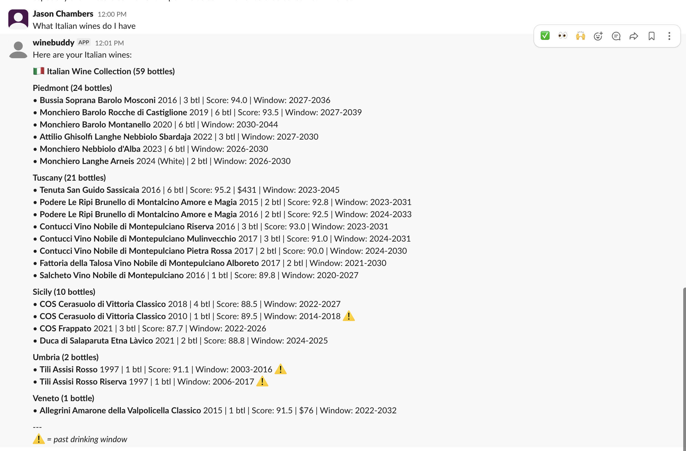

# WineBuddy Slack App

A Slack bot that lets you query your personal wine cellar using natural language. It answers by calling the Claude API, with the
[winebuddy](https://github.com/jasondchambers/winebuddy) skill as its instructions and tools that look the cellar up
through the winebuddy CLI.



## Architecture


What happens when someone asks a question:

1. Slack delivers the message to `main.py` over Socket Mode. For a reply in a thread, `main.py` reads the thread so
   far back from Slack.
2. `main.py` hands the question and the thread to `ask.py`.
3. `ask.py` runs `winebuddy --refresh` to bring the cellar up to date.
4. `ask.py` sends the question to the Claude API, with the winebuddy skill (`SKILL.md`) as the system prompt.
5. Claude's `query_wines` and `discover` tool calls run the winebuddy CLI. Steps 4 and 5 repeat until Claude
   answers, up to 10 rounds.
6. The answer streams back into the Slack thread.

The cellar CLI and skill are in [winebuddy](https://github.com/jasondchambers/winebuddy), and the cellar is kept up to
date from [CellarTracker](https://www.cellartracker.com/) by
[winebuddy-sync-with-cellartracker](https://github.com/jasondchambers/winebuddy-sync-with-cellartracker).
[docs/architecture.html](docs/architecture.html) has the diagram with clickable links and more detail; open it in a
browser from a clone (`open docs/architecture.html` on macOS).

## Setup

### Prerequisites

- Python 3.10+
- [uv](https://github.com/astral-sh/uv) package manager
- A Claude API key
- [winebuddy](https://github.com/jasondchambers/winebuddy) cloned to `~/.winebuddy` (or set `WINEBUDDY_DIR`), with your
  `cellar.csv` in it. The bot reads its `SKILL.md` directly, so it doesn't need to be installed as a Claude Code skill
- A Slack workspace where you can install apps

### Installation

```bash
git clone <repo-url>
cd winebuddy-slack-app
uv sync
```

### Slack App Configuration

1. Create a new Slack app at https://api.slack.com/apps
2. Enable **Socket Mode** in your app settings
3. Generate an **App-Level Token** with `connections:write` scope
4. Under **OAuth & Permissions**, add these bot token scopes:
   - `chat:write`
   - `app_mentions:read`
   - `im:history` (for DMs)
   - `channels:history` (for public channels)
5. Enable **Event Subscriptions** and subscribe to:
   - `message.im`
   - `message.channels`
   - `app_mention`
6. Install the app to your workspace
7. Invite the app into a channel

### Environment Variables

```bash
export SLACK_BOT_TOKEN="xoxb-..."   # Bot User OAuth Token
export SLACK_APP_TOKEN="xapp-..."   # App-Level Token for Socket Mode
export ANTHROPIC_API_KEY="..."
```

1Password is recommended for managing these secrets.

## Usage

```bash
uv run python main.py
```

Or with 1Password for secrets injection:

```bash
op run --environment $OP_ENVIRONMENT_ID -- uv run python main.py
```

To ask a question the way the bot does, without Slack (logs each lookup and the tokens used):

```bash
uv run python ask.py "What French wines do I have?"
```

Then message the bot in Slack:

> What French wines do I have?

> Show me wines ready to drink this year

> Do I have any Pinot Noir?

## Security Features

- **Input sanitization** - Strips control characters, enforces length limits
- **Rate limiting** - 5 second cooldown between requests per user
- **No shell access** - Claude's only tools are `query_wines` and `discover`, which run `winebuddy.py` with an
  argument list (no shell) and its parameterized queries
- **Bounded cost** - One question can make at most 10 rounds of tool calls
- **Bot loop prevention** - Ignores messages from other bots

## Configuration

| Constant | Default | Description |
|----------|---------|-------------|
| `MAX_MESSAGE_LENGTH` | 2000 | Maximum characters per message |
| `RATE_LIMIT_SECONDS` | 5 | Cooldown between requests per user |
| `MAX_HISTORY_MESSAGES` | 20 | Earlier thread messages sent with a follow-up question |

## Architecture

```
Slack (Socket Mode) → main.py → ask.py → Claude API (Sonnet) ⇄ query_wines / discover → winebuddy.py → cellar.db
```

The app uses Slack's Socket Mode for real-time communication without needing a public HTTP endpoint.

Before each question, `ask.py` runs `winebuddy.py --refresh` so the database matches `cellar.csv`, and passes what
changed to Claude to report. Claude gets the winebuddy skill (`SKILL.md`, without its front matter, plus
bot-specific instructions) as its system prompt. See the [winebuddy repository](https://github.com/jasondchambers/winebuddy) for skill installation and configuration.
The cellar inventory is still managed by the CellarTracker app. Winebuddy is kept in sync periodically by 
[winebuddy-sync-with-cellartracker](https://github.com/jasondchambers/winebuddy-sync-with-cellartracker)
